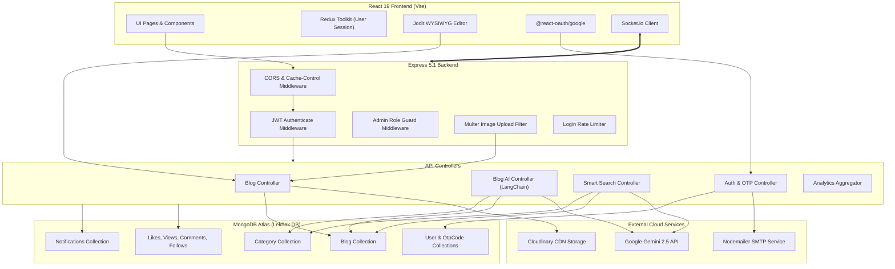
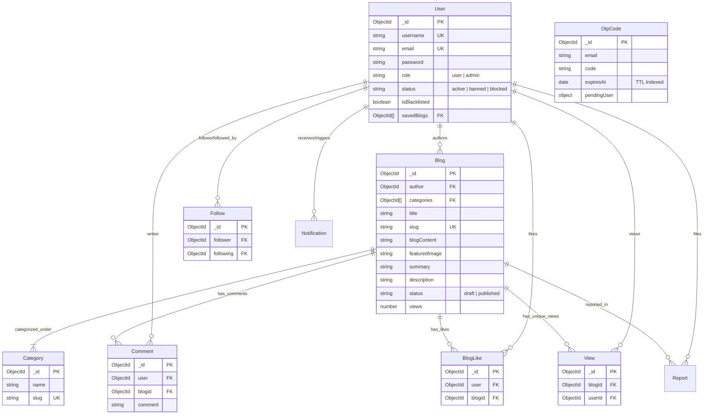
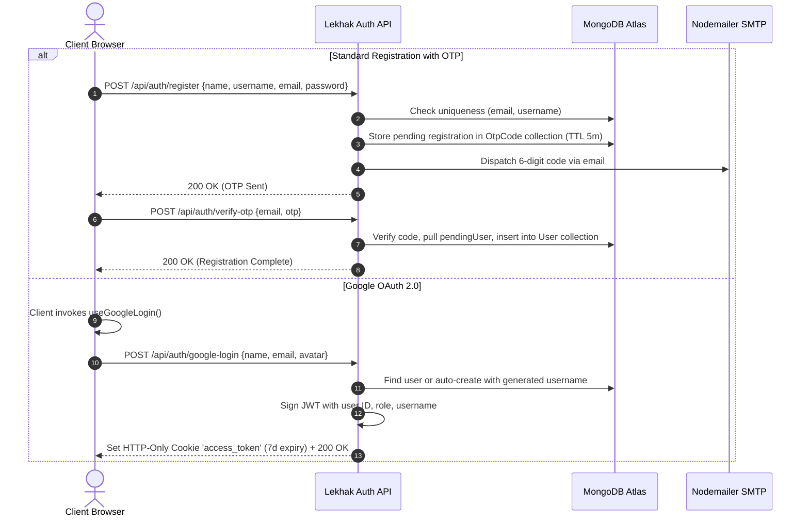
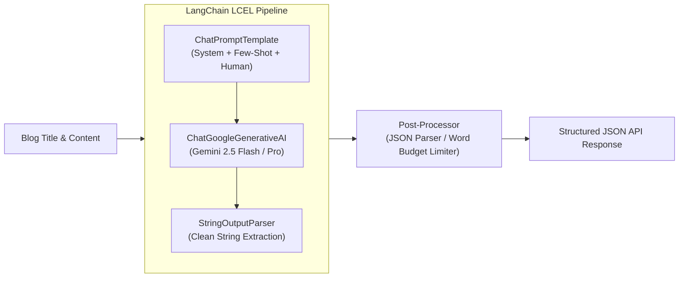
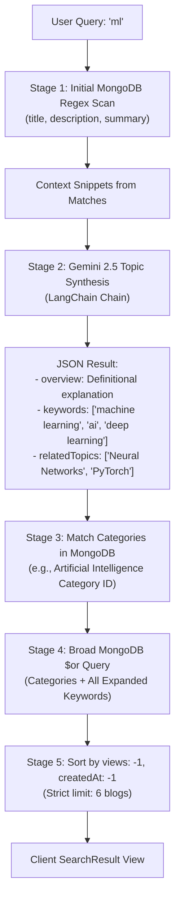

# Project Architecture & Codebase Knowledge Graph: Lekhak

> **Platform:** Lekhak (लेखक) – A Full-Stack AI-Powered Blogging & Content Creation Platform  
> **Repository:** `hetul2309/Lekhak`  
> **Document Status:** 100% Source-Code Verified (AST + Static Code Analysis)  
> **Knowledge Graph Engine:** Graphify v0.9.105 (AST Extraction: 1,067 nodes, 3,719 edges, 65 communities across 230 source files)

---

## Table of Contents

1. [Project Overview & Problem Statement](#1-project-overview--problem-statement)
2. [Main Features](#2-main-features)
3. [Complete Technology Stack](#3-complete-technology-stack)
4. [High-Level System Architecture](#4-high-level-system-architecture)
5. [Repository Folder Structure](#5-repository-folder-structure)
6. [Frontend Architecture](#6-frontend-architecture)
7. [Backend Architecture](#7-backend-architecture)
8. [REST API Inventory](#8-rest-api-inventory)
9. [Database Schema & Entity Relationships](#9-database-schema--entity-relationships)
10. [Authentication & Authorization Lifecycle](#10-authentication--authorization-lifecycle)
11. [Blog Creation, Editing & Publishing Lifecycle](#11-blog-creation-editing--publishing-lifecycle)
12. [Media Storage & Cloudinary Pipeline](#12-media-storage--cloudinary-pipeline)
13. [LangChain & Google Gemini 2.5 Architecture](#13-langchain--google-gemini-25-architecture)
14. [Smart Semantic Search Implementation](#14-smart-semantic-search-implementation)
15. [Automated Article Categorization & Tagging](#15-automated-article-categorization--tagging)
16. [Article Summarization & Description Generation](#16-article-summarization--description-generation)
17. [Multi-Model AI Fallback & Error Handling](#17-multi-model-ai-fallback--error-handling)
18. [Security & Reliability Considerations](#18-security--reliability-considerations)
19. [Design Decisions & Architectural Trade-offs](#19-design-decisions--architectural-trade-offs)
20. [Technical Limitations & Future Improvements](#20-technical-limitations--future-improvements)
21. [Key Source Files to Read First](#21-key-source-files-to-read-first)
22. [Interview-Relevant Technical Highlights](#22-interview-relevant-technical-highlights)

---

## 1. Project Overview & Problem Statement

Modern digital publishing platforms face three fundamental challenges:
1. **Content Categorization Friction:** Writers frequently mistag or omit taxonomies, degrading discoverability.
2. **Search Inefficiency:** Traditional database keyword or substring searches miss synonyms, acronyms, and conceptual context (e.g., searching `"ml"` fails to discover articles titled *"Deep Learning Neural Networks"*).
3. **Reader Fatigue & Engagement Drop-off:** Long-form technical articles lack concise executive summaries, and platforms rarely personalize feeds based on active reading behavior and time-decayed interest.

**Lekhak** solves these challenges by combining a full-stack MERN foundation with Google Gemini 2.5 and LangChain orchestration to deliver:
- Automated category suggestion grounded in platform taxonomy without hallucination.
- Real-time generative summarization and SEO description synthesis with token-budget enforcement and user rate-limits.
- Semantic search overview synthesis and query keyword expansion bridging natural language search to MongoDB indexing.
- Multi-signal personalized content recommendations based on likes, bookmarks, category affinities, and exponential recency decay.

---

## 2. Main Features

- **Rich WYSIWYG Content Creation:** Powered by `JoditEditor` with full formatting, code blocks, clean HTML sanitization, and autosave.
- **AI Content Moderation:** Keyword and severity detection filtering illegal content, harassment, and spam before publishing.
- **Automated Taxonomy Tagging:** LangChain `ChatPromptTemplate` invoking Google Gemini 2.5 to match blog text against existing MongoDB categories.
- **One-Click AI Summarization:** Dynamic 3-paragraph plain-text summary generation with per-user refresh caps (max 3 per post).
- **Smart Search & Conceptual Synthesis:** Combines direct DB matching with Gemini-driven topic definitions and keyword expansion.
- **Personalized Recommendations:** Score-based ranking weighing category affinities, author follows, total popularity, and 30-day time decay.
- **Dual Authentication Suite:**
  - Secure Email/Password registration with 6-digit Nodemailer OTP verification and TTL expiry.
  - One-click Google OAuth 2.0 (`@react-oauth/google`) with automatic profile provisioning.
  - Dedicated Direct Admin Portal with master bypass authentication.
- **Social Engagement & Real-time Alerts:** Follow/unfollow authors, like posts, comment threads, unique view tracking, and real-time Socket.io notifications.
- **Creator Analytics Dashboard:** Visual 30-day engagement trends (views, likes, comments) aggregated via MongoDB pipelines, follower vs. non-follower breakdown, and automated performance insights.

---

## 3. Complete Technology Stack

| Layer | Technology | Version | Purpose in Lekhak |
| :--- | :--- | :--- | :--- |
| **Frontend Framework** | React.js | `^19.1.1` | Client UI rendering and reactive state |
| **Frontend Build Tool** | Vite | `^7.1.6` | Development server and production bundling |
| **Styling & Icons** | Tailwind CSS / Lucide | `^4.1.13` / `^0.544.0` | Modern responsive UI, glassmorphic themes, and iconography |
| **State Management** | Redux Toolkit & Persist | `^2.9.0` / `^6.0.0` | Global user session state persisted across page reloads |
| **Rich Text Editor** | Jodit React | `^5.3.21` | In-browser WYSIWYG editor for blog composition |
| **Backend Framework** | Node.js / Express.js | `v20+` / `^5.1.0` | REST API routing, controllers, and middleware |
| **Database** | MongoDB Atlas / Mongoose | `^8.18.1` | Document storage, indexes, TTL expiries, and aggregation |
| **AI Orchestration** | LangChain Core & Google GenAI | `^1.2.5` / `^2.2.0` | Prompts, LCEL chains, output parsing, and Gemini 2.5 API |
| **AI LLM Foundation** | Google Gemini 2.5 | `2.5-flash` / `2.5-pro` | Primary LLMs with multi-tier model fallbacks |
| **Real-Time WebSockets** | Socket.io / Socket.io-client | `^4.8.1` | Instant in-app notifications on likes, comments, and follows |
| **Media Cloud Storage** | Cloudinary & Multer | `^2.7.0` / `^2.0.2` | Image upload, CDN delivery, and multipart disk handling |
| **Email Transport** | Nodemailer | `^9.0.5` | SMTP transport for verification OTPs and password resets |
| **Authentication** | JWT (`jsonwebtoken`) & BcryptJS | `^9.0.2` / `^3.0.2` | HTTP-only cookie tokens, password hashing, and role guards |
| **Testing Framework** | Jest & Vitest | `^30.2.0` / `^4.0.8` | 100% test coverage across controllers, utils, and UI |

---

## 4. High-Level System Architecture



---

## 5. Repository Folder Structure

```text
Lekhak/
├── api/                             # Node.js & Express.js Backend Service
│   ├── config/                      # Cloudinary & Multer configuration
│   │   ├── cloudinary.js            # Cloudinary SDK credentials & exports
│   │   └── multer.js                # DiskStorage & MIME type whitelist filter
│   ├── controllers/                 # Route handler business logic
│   │   ├── Auth.controller.js       # Register, OTP verify, Login, Google OAuth, Reset
│   │   ├── blog.controller.js       # CRUD, recommendation feeds, best of week
│   │   ├── blogAI.controller.js     # LangChain + Gemini 2.5 tagging, summary, description
│   │   ├── BlogLike.controller.js   # Like / unlike logic & socket notifications
│   │   ├── Category.controller.js   # Taxonomy management
│   │   ├── Comment.controller.js    # Comment creation, deletion & moderation
│   │   ├── follow.controller.js     # User follow/unfollow graphs
│   │   ├── moderation.controller.js # Endpoint proxies to moderation utilities
│   │   ├── notification.controller.js # Notification retrieval and read-state toggles
│   │   ├── reports.controller.js    # Content reporting workflow for moderation
│   │   ├── save.controller.js       # User saved/bookmarked articles
│   │   ├── smartSearch.controller.js # AI-synthesized semantic search & keyword expansion
│   │   ├── User.controller.js       # User profile, avatar update, and user management
│   │   └── view.controller.js       # Unique view counter recording
│   ├── middleware/                  # Request lifecycle interceptors
│   │   ├── admin.js                 # Verifies req.user.role === 'admin'
│   │   └── authenticate.js          # Decodes access_token cookie, checks blacklist
│   ├── models/                      # Mongoose Schema Definitions
│   │   ├── blog.model.js            # Articles, draft states, partial unique slugs
│   │   ├── bloglike.model.js        # Article likes mapping
│   │   ├── category.model.js        # Category taxonomies and unique slugs
│   │   ├── comment.model.js         # User comments linked to blogs
│   │   ├── follow.model.js          # Follower/Following relationship pairs
│   │   ├── notification.model.js    # In-app notifications with read status
│   │   ├── OtpCode.model.js         # Temporary registration cache with TTL index
│   │   ├── PasswordResetRequest.model.js # Password reset request tracking
│   │   ├── report.model.js          # Reported blog logs and review states
│   │   ├── user.model.js            # User accounts, usernames, roles, and bookmarks
│   │   ├── verificationToken.model.js # Token verification with TTL expiration
│   │   └── view.model.js            # Unique blog views index
│   ├── routes/                      # Express route mappers
│   ├── scripts/                     # Database seed and maintenance scripts
│   ├── tests/                       # Jest automated test suites (662+ passing unit tests)
│   ├── utils/                       # Reusable utility modules (mailer, moderation, OTP)
│   ├── index.js                     # Server entrypoint, Socket.io initialization & MongoDB connect
│   └── package.json                 # Backend dependencies and test scripts
│
├── client/                          # React 19 Frontend (Vite SPA)
│   ├── src/
│   │   ├── assets/                  # Logos, icons, and SVG loading spinners
│   │   ├── components/              # Modular UI components
│   │   │   ├── ui/                  # Radix UI primitives (Button, Dialog, Dropdown, Table)
│   │   │   ├── Notifications/       # Real-time notification bell and live dropdown
│   │   │   ├── ActivityHeatmap.jsx  # User contribution heatmap
│   │   │   ├── ArticleCard.jsx      # Compact post card with summary trigger
│   │   │   ├── BlogCard.jsx         # Full feed card with author, tags, and actions
│   │   │   ├── CategoryBar.jsx      # Sticky top category bar
│   │   │   ├── Editor.jsx           # Jodit WYSIWYG rich-text wrapper
│   │   │   ├── ModerationErrorDisplay.jsx # Detailed line-by-line moderation modal
│   │   │   ├── ProtectedRoute.jsx   # Client-side authentication gate
│   │   │   ├── SummaryModal.jsx     # AI summary viewer modal
│   │   │   └── Topbar.jsx           # Header with search, write button, and profile
│   │   ├── context/                 # React Context Providers
│   │   │   └── NotificationsProvider.jsx # Socket.io notification manager
│   │   ├── helpers/                 # Route names, toast triggers, and env loaders
│   │   ├── hooks/                   # Custom hooks (useFetch, useIsMobile)
│   │   ├── Layout/                  # Standard page layout with sidebar
│   │   ├── pages/                   # Application view routes
│   │   │   ├── Blog/AddBlog.jsx     # Post editor with AI tagging and thumbnail upload
│   │   │   ├── Blog/BlogDetails.jsx # Author blog management dashboard
│   │   │   ├── Index.jsx            # Main feed (For You, Following, Recent)
│   │   │   ├── Landing.jsx          # Public marketing page for guests
│   │   │   ├── ProfileAnalytics.jsx # Creator statistics and engagement charts
│   │   │   ├── SearchResult.jsx     # Semantic search page with AI overview
│   │   │   ├── SignIn.jsx & SignUp.jsx # Auth pages with OTP and Google OAuth
│   │   │   └── SingleBlogDetails.jsx # Public article reader with comments & views
│   │   ├── redux/                   # Redux state slices (user session)
│   │   ├── App.jsx                  # React Router configuration
│   │   └── main.jsx                 # React root DOM rendering and Google OAuth provider
│   ├── tests/                       # Vitest component and hook test suites
│   ├── package.json                 # Frontend dependencies and Vite scripts
│   └── vite.config.js               # Vite bundler plugins and path aliases (@/)
│
└── graphify-out/                    # Codebase Knowledge Graph & Architecture Artifacts
    ├── graph.json                   # Full AST node and relationship graph
    ├── graph.html                   # Interactive graph visualization
    ├── GRAPH_REPORT.md              # Community clusters and metric analysis
    └── PROJECT_ARCHITECTURE.md      # This comprehensive architectural reference
```

---

## 6. Frontend Architecture

### Application Bootstrapping
- `client/src/main.jsx`: Wraps the application inside `ReduxProvider` (with `redux-persist` `PersistGate`), `GoogleOAuthProvider` (configured with `VITE_GOOGLE_CLIENT_ID`), and renders `<App />`.
- `client/src/App.jsx`: Declares the `BrowserRouter` and nests all views inside `NotificationsProvider`.

### Component Hierarchy & Layout
- **Public Shell:** Unauthenticated routes (`/`, `/signin`, `/signup`, `/forgot-password`) render standalone without application headers or sidebars.
- **Authenticated Shell (`<Layout />`):** Contains `<Topbar />` (search box, quick action buttons, user menu) and `<AppSidebar />` (collapsible navigation drawer).
- **Protected Views:** Wrapped in `<ProtectedRoute>`:
  ```jsx
  // client/src/components/ProtectedRoute.jsx
  export default function ProtectedRoute({ children }) {
    const token = localStorage.getItem("token");
    if (!token) return <Navigate to="/signin" replace />;
    return children;
  }
  ```

### State Management
- **Redux Toolkit (`client/src/redux/user/user.slice.js`):**
  - Manages `currentUser`, `isLoggedIn`, and profile details.
  - Persisted in browser `localStorage` using `redux-persist` under the key `root`.
- **Real-Time Context (`client/src/context/NotificationsProvider.jsx`):**
  - Connects to backend Socket.io server upon user identification.
  - Subscribes to `notification:new` events and maintains live unread counts without page reloads.

---

## 7. Backend Architecture

### Server Bootstrapping (`api/index.js`)
1. **HTTP & WebSocket Server Setup:** Instantiates Express `app` and wraps it with Node's native `http.createServer(app)` to attach `socket.io.Server`.
2. **Reverse Proxy Trust:** Configured with `app.set('trust proxy', 1)` to correctly receive client IP and protocol headers behind proxies like Render and Vercel.
3. **Security Headers:** Enforces `no-store, no-cache, must-revalidate` across all responses to prevent sensitive user data leakage via browser back-forward cache (BFCache).
4. **CORS Configuration:** Validates origin against dynamic `FRONTEND_URL` environment lists while permitting credential exchange (`credentials: true`).
5. **Rate Limiting:** Protects `/api/auth/login` via `express-rate-limit` (5 attempts per 15-minute window per IP).
6. **Database Connection:** Connects to MongoDB Atlas specifying `{ dbName: 'Lekhak' }`.

---

## 8. REST API Inventory

### Authentication (`/api/auth`)
| Method | Endpoint | Access | Purpose |
| :--- | :--- | :--- | :--- |
| `POST` | `/api/auth/register` | Public | Generates registration OTP and stores pending user in TTL cache |
| `POST` | `/api/auth/verify-otp` | Public | Verifies 6-digit OTP and commits user to `users` collection |
| `POST` | `/api/auth/resend-otp` | Public | Resends registration OTP (rate-limited by interval) |
| `POST` | `/api/auth/login` | Public (Rate-limited) | Authenticates credentials, checks blacklist, issues JWT cookie |
| `POST` | `/api/auth/google-login` | Public | Validates Google OAuth profile, auto-provisions user, issues JWT |
| `POST` | `/api/auth/logout` | Authenticated | Clears `access_token` cookie |
| `POST` | `/api/auth/request-password-reset` | Public | Creates password-reset verification token and dispatches email |
| `POST` | `/api/auth/reset-password` | Public | Verifies reset code and updates user password hash |
| `GET` | `/api/auth/check-username` | Public | Validates format and checks uniqueness of username |

### Blog Management (`/api/blog`)
| Method | Endpoint | Access | Purpose |
| :--- | :--- | :--- | :--- |
| `POST` | `/api/blog/add` | Authenticated | Creates draft or published blog with Cloudinary thumbnail upload |
| `PUT` | `/api/blog/update/:blogid` | Authenticated | Updates existing blog, handles draft-to-published transitions |
| `DELETE` | `/api/blog/delete/:blogid` | Authenticated | Deletes blog post, associated likes, and comments |
| `GET` | `/api/blog/get-all-blogs` | Public | Retrieves all published blogs with author and category population |
| `GET` | `/api/blog/get-blog/:slug` | Public | Fetches single article by slug |
| `GET` | `/api/blog/personalized-home` | Authenticated | Returns personalized feed based on user interaction weights |
| `GET` | `/api/blog/related/:blogId` | Public | Returns personalized or category-based related posts |
| `GET` | `/api/blog/best-of-week` | Public | Retrieves top 3 highest-liked articles published in last 7 days |
| `GET` | `/api/blog/get-drafts` | Authenticated | Lists unpublished draft articles for current author |
| `GET` | `/api/blog/search` | Public | Basic regex search across titles, slugs, and authors |

### Artificial Intelligence (`/api/blog` - AI Router)
| Method | Endpoint | Access | Purpose |
| :--- | :--- | :--- | :--- |
| `POST` | `/api/blog/categorize` | Authenticated | LangChain + Gemini taxonomy matching |
| `GET` | `/api/blog/:blogId/summary` | Authenticated | Generates or retrieves cached plain-text summary (supports `?refresh=true`) |
| `POST` | `/api/blog/generate-description` | Authenticated | Generates SEO-optimized 300-character description for post |
| `GET` | `/api/blog/smart-search-overview` | Public | Synthesizes topic overview and expands search keywords via Gemini |

### Engagement, Social & Analytics
| Method | Endpoint | Access | Purpose |
| :--- | :--- | :--- | :--- |
| `POST` | `/api/bloglike/toggle-like` | Authenticated | Toggles like status and dispatches Socket notification |
| `POST` | `/api/comment/add` | Authenticated | Runs moderation check and inserts comment |
| `POST` | `/api/view/add` | Authenticated | Records unique view and increments post view counter |
| `POST` | `/api/follow/toggle` | Authenticated | Toggles follow relationship between users |
| `POST` | `/api/save/toggle/:blogId` | Authenticated | Bookmarks or un-bookmarks article in user's `savedBlogs` array |
| `GET` | `/api/analytics` | Authenticated | Returns 30-day views/likes/comments trends and audience breakdown |
| `POST` | `/api/report/add` | Authenticated | Submits moderation report for offensive content |

---

## 9. Database Schema & Entity Relationships



### Critical Indexing Strategies
1. **Partial Unique Slug Index:**  
   `blogSchema.index({ slug: 1 }, { unique: true, partialFilterExpression: { status: 'published' } })`  
   *Why:* Ensures published posts have distinct SEO slugs while permitting authors to save multiple drafts without slug collision errors.
2. **Compound Unique View Index:**  
   `viewSchema.index({ blogId: 1, userId: 1 }, { unique: true })`  
   *Why:* Prevents view-count inflation by strictly enforcing one unique view per user per blog.
3. **Compound Unique Follow Index:**  
   `followSchema.index({ follower: 1, following: 1 }, { unique: true })`  
   *Why:* Ensures idempotent follow relationships.
4. **TTL Expiration Index:**  
   `OtpCodeSchema.index({ expiresAt: 1 }, { expireAfterSeconds: 0 })`  
   *Why:* MongoDB background threads automatically garbage-collect expired OTP records.

---

## 10. Authentication & Authorization Lifecycle



### Authorization Enforcement
- **Cookie Security:** Handled in `issueAuthCookie`:
  ```javascript
  res.cookie("access_token", token, {
    httpOnly: true,
    secure: process.env.NODE_ENV === 'production',
    sameSite: process.env.NODE_ENV === 'production' ? "none" : "lax",
    path: "/"
  });
  ```
- **Token Verification (`api/middleware/authenticate.js`):**
  - Extracts `req.cookies.access_token`.
  - Verifies signature against `JWT_SECRET`.
  - Checks if user exists and confirms `isBlacklisted === false`.
- **Role Guard (`api/middleware/admin.js`):**
  - Asserts `req.user.role === 'admin'`; immediately rejects unauthorized users with `403 Forbidden`.

---

## 11. Blog Creation, Editing & Publishing Lifecycle

1. **Composition:** Writer enters rich HTML into `Editor.jsx` (Jodit).
2. **AI Assistance (Optional):**
   - Click *Categorize with AI* → Backend runs Gemini taxonomy chain and auto-selects tags.
   - Click *Generate Description* → Backend creates a 2-4 line SEO summary.
3. **Form Submission (`multipart/form-data`):**
   - Data payload stringified alongside cover image file.
4. **Backend Ingestion (`api/controllers/blog.controller.js`):**
   - `upload.single('file')` processes image through Multer.
   - If image present, uploads to Cloudinary and acquires CDN URL.
   - **Pre-Publish Moderation:** Combines `TITLE`, `SLUG`, and decoded plain-text content into `combinedForModeration`.
   - Executes `moderateBlog()`. If flagged, rejects request with 400 and structured line errors.
   - Slug normalized using `slugify(title, { lower: true, strict: true })`.
   - Persists document in MongoDB.
   - Triggers `notifyFollowersNewPost` to alert subscribers in real-time.

---

## 12. Media Storage & Cloudinary Pipeline

- **Storage Setup (`api/config/cloudinary.js`):** Configured with API Key, Secret, and Cloud Name.
- **Upload Interceptor (`api/config/multer.js`):**
  - Validates MIME types (`image/png`, `image/jpg`, `image/jpeg`, `image/webp`).
  - Stores binary stream temporarily to disk before Cloudinary dispatch.
- **CDN Optimization:** Cloudinary transforms and delivers high-performance WebP/responsive formats across global edge nodes.

---

## 13. LangChain & Google Gemini 2.5 Architecture

Lekhak leverages LangChain's Expression Language (LCEL) to construct deterministic, composable pipelines:



### Model Initialization
```javascript
const model = new ChatGoogleGenerativeAI({
  apiKey: process.env.GEMINI_API_KEY,
  model: modelId, // Starts at gemini-2.5-flash
  temperature: 0.3,
  maxOutputTokens: 768,
});
```

---

## 14. Smart Semantic Search Implementation

> [!IMPORTANT]
> Lekhak's semantic search does **not** rely on external vector databases (e.g., Pinecone or FAISS). Instead, it implements an **AI Query-Expansion & Semantic Concept Synthesis** architecture.



---

## 15. Automated Article Categorization & Tagging

- **Endpoint:** `POST /api/blog/categorize`
- **Methodology:**
  1. Retrieves all existing categories from MongoDB (`Category.find().select('name slug')`).
  2. Constructs a glossary: `- Technology (slug: technology)\n- Web Dev (slug: web-dev)`.
  3. Formulates a strict system prompt instructing Gemini to:
     *Return a JSON array of category slugs. Never invent new categories.*
  4. Parses the model output using `tryParseCategoryResponse` (handles pure JSON arrays or comma-delimited strings).
  5. Maps returned slugs directly to MongoDB `_id` references, guaranteeing database integrity.

---

## 16. Article Summarization & Description Generation

### Summarization (`GET /api/blog/:blogId/summary`)
- Extracts plain text from the article (strips HTML and decodes entities).
- Feeds content into a prompt instructing Gemini to deliver concise 2-3 sentence paragraphs without markdown, bullets, or bold tags.
- Enforces a strict 500-word ceiling.
- Caches the summary directly on `blog.summary` in MongoDB.
- Limits user refreshes via `summaryRefreshCounts` (maximum 3 refreshes per user per article).

### Description Generation (`POST /api/blog/generate-description`)
- Focuses on SEO and click-through appeal.
- Generates a concise 2-4 line description capped at 300 characters.

---

## 17. Multi-Model AI Fallback & Error Handling

To ensure 99.9% uptime despite regional Google API quotas, model deprecations, or rate limits, Lekhak uses an ordered fallback ring:

```text
1. process.env.GEMINI_MODEL (Default: gemini-2.5-flash)
2. gemini-2.5-pro
3. gemini-2.5-flash
4. gemini-2.5-flash-lite
5. gemini-2.0-flash
6. gemini-2.0-flash-lite
7. gemini-1.5-pro
8. gemini-1.5-flash
9. gemini-pro
```

If a candidate model throws an error (e.g., 404 Model Not Found, 429 Quota Exceeded, or 503 Overloaded), the catch block logs the error and immediately retries the chain with the next candidate in the ring.

---

## 18. Security & Reliability Considerations

1. **XSS Protection:** Content rendered from the Jodit editor is sanitized, and moderation scripts strip raw HTML markup before AI processing.
2. **Brute Force Protection:** Express rate limiting restricts brute-force attempts on sensitive endpoints.
3. **No-Store Caching:** Prevents browser history caching of sensitive authenticated responses.
4. **Content Moderation Engine (`api/utils/moderation.js`):**
   - High-precision keyword analysis targeting violent threats, hate speech, child abuse, and scams.
   - Non-violent programming terms (e.g., `execute`, `cp`) are preserved to prevent false positives on coding articles.
5. **Secure Cookies:** JWT access tokens cannot be accessed via JavaScript (`httpOnly: true`), mitigating token theft via XSS.

---

## 19. Design Decisions & Architectural Trade-offs

| Decision | Chosen Approach | Alternative Considered | Trade-off Rationale |
| :--- | :--- | :--- | :--- |
| **Search Engine** | AI Keyword Expansion + MongoDB | Vector Database (Pinecone/Weaviate) | Avoids operational overhead and synchronization lag of a dedicated vector database while delivering semantic comprehension through Gemini. |
| **Category Selection** | Strict DB Glossary Grounding | Unconstrained AI Tag Generation | Prevents database taxonomy bloat with thousands of near-duplicate user tags (e.g., `js`, `javascript`, `java-script`). |
| **Authentication** | Dual (OTP + Google OAuth) | Pure OAuth or Pure Password | Accommodates institutional/enterprise users who lack Google accounts without sacrificing 1-click convenience for others. |
| **Draft Slugs** | Partial Filter Indexing | Permissive Nullable Slugs | Allows writers to draft multiple articles titled "Draft" while guaranteeing unique URLs upon publication. |

---

## 20. Technical Limitations & Future Improvements

1. **Search Scalability:** As the article catalog exceeds 100,000 posts, regex matching on MongoDB will require migration to MongoDB Atlas Search (Lucene indexes) or vector embeddings.
2. **WebSocket Clustering:** Socket.io currently operates on a single Node process. Multi-instance scaling will require a Redis adapter (`@socket.io/redis-adapter`).
3. **Draft Auto-save Granularity:** Drafts are saved at whole-document intervals rather than using operational transformation (OT) or CRDTs for real-time collaborative editing.

---

## 21. Key Source Files to Read First

To rapidly understand the codebase, inspect files in this order:

1. `api/index.js` - Express and Socket.io gateway initialization.
2. `api/controllers/blogAI.controller.js` - LangChain & Gemini 2.5 implementation.
3. `api/controllers/smartSearch.controller.js` - Semantic search & query expansion.
4. `api/controllers/blog.controller.js` - Post lifecycle, recommendation algorithms, and feed scoring.
5. `api/controllers/Auth.controller.js` - Authentication, OTP verification, and Google OAuth.
6. `client/src/App.jsx` - Client-side routing and protected boundaries.
7. `client/src/pages/Blog/AddBlog.jsx` - Blog editor, AI categorization integration, and upload pipeline.

---

## 22. Interview-Relevant Technical Highlights

When discussing Lekhak in a technical interview, emphasize:

1. **Defensive AI Engineering:** The multi-model fallback across Gemini 2.5 and 2.0 tiers ensures zero user disruption during API quota spikes.
2. **Grounded Generative Extraction:** System prompt engineering restricts category output strictly to platform database records, eliminating hallucinations.
3. **Compound Recommendation Heuristics:** How `getPersonalizedHome` balances explicit signals (bookmarks +3), implicit signals (likes +2), recency decay (boost for interactions within 30 days), and cold-start fallback logic.
4. **Full-Stack Resilience:** Integration of TTL-indexed OTP codes in MongoDB, HTTP-Only JWT security, and real-time Socket.io notifications.

---
*Generated by Graphify Knowledge Extraction Engine for Lekhak.*

